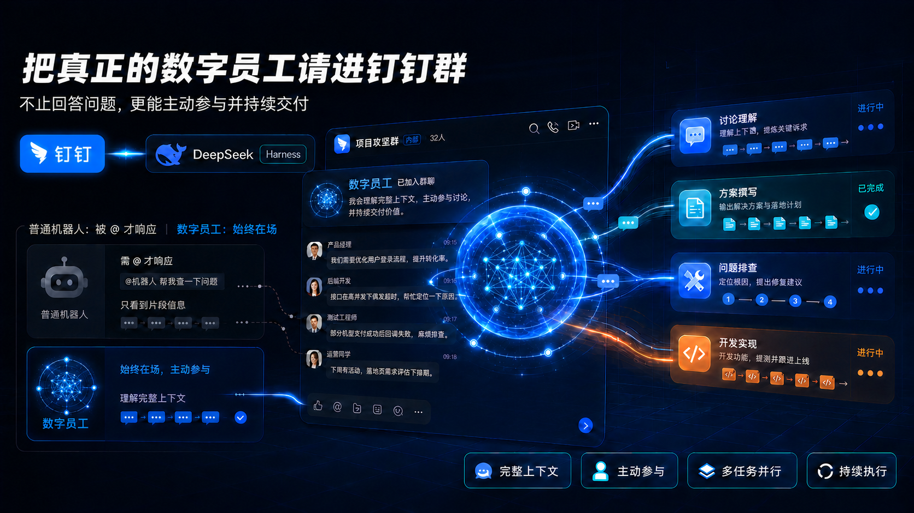

# DingTalk DSH Assistant

看板顶部提示均支持手动关闭；操作成功提示在 5 秒后自动关闭。连接和操作错误保留至手动关闭或问题恢复，同一次持续错误不会因自动刷新反复弹回。

运行看板的 **协调工作** 页按持久实体展示：每笔定时安排跨改期只有一行，独立无计划触发按触发身份展示，其余不受计划管理的任务按协调批次展示一笔调度；创建、修改和查询消息只作历史，不重复成工作。默认按既有群列表顺序选中首个有效群，保留手选、紧凑列表、分页、5 秒刷新、独立键盘焦点及任务详情往返。列表只有一个实际主要结果：提醒的发送失败、送达未知、待送达和已送达按真实通知事实表达；任务协调突出“前置任务正式完成 → 调度目标任务”的关系，只报告等待前置、待调度、调度成功或真实调度失败，不混入目标任务的执行中或完成状态。目标任务执行由其任务页面负责；等待前置时列出尚未满足的具体任务并支持跳转。调度成功只能来自真实命令回执，不能从目标任务 active、fulfilled 或 completed 反推。详情分开显示计划控制、实际触发结果与真实后续触发/重试记录，取消或暂停不抹去已有送达和失败事实；无记录不承诺重试。原文、变更、历史触发与证据按需展开。实体接口为 `/state/coordination-work`，旧来源接口保留历史诊断，不制造未接纳或被拒绝输入的工作行。读取沿用本机 resident 的 Host/Origin 边界，正文与证据不是脱敏公共导出。见[看板设计合同](docs/manual/observer-design-contract.md)和[API 合同](docs/api/coordination-observer.md)；源码功能不表示共享部署已升级。

`dingtalk-dsh-assistant` 把钉钉群聊接入 [DeepSeek Harness（DSH）](https://github.com/deepseek-ai/DeepSeek-Harness)。当前 resident 将消息单元独占交给话题链或独立任务协调层：普通讨论与单项交办沿话题处理，多任务安排和定时计划可不依附 Topic，直接关联原 Task，不创建一个总 Task 替代它们。任务会话（Owner）持续负责完整目标，独立执行会话使用所选后端的实际工具完成受托工作。

当前源码不再装配固定 workflow、DAG、阶段或节点调度器。从旧 workflow 体系切换到任务会话体系，按[任务会话清洁启动 Runbook](docs/ops/task-session-clean-start.md)使用全新任务库与 Resident domain，保留隔离的旧数据，不导入旧任务或重发旧通知。已经使用任务会话体系的实例升级协调账本，则按[协调账本 v1→v2 迁移 Runbook](docs/ops/coordination-ledger-migration.md)保留原任务与回执；不要把这两种升级场景混用。本文描述源码行为，不表示已发布、已部署或通过真实钉钉验收。

## 任务责任与执行边界

- 原消息、来源单元、归属版本、摘要及决策操作记录继续持久保存。来源由话题链或独立协调层独占，澄清与重启不重复派发；路由与协调会话只解释、归属和交办真实来源，不执行业务工作。
- 每任务一个持久任务会话（Owner），独立维护当前目标、需求版本与控制版本。它可直接使用当前 Agent 配置提供的原生工具、按需读取技能，也可委派、读执行结果、取消执行及提交本轮结论；不另设统筹会话工具白名单。
- 每个受托执行有自己的 `executionId`、后端会话、租约和工作目录，后端为 DSH 原生 Session 或 Claude Code CLI。同任务可并行多个执行，同一执行只能单飞；续办保留原后端和会话身份，递增输入版本，不伪造 Run/节点。
- 一个 Task 的执行会话数量由统筹按实际工作决定，不设最低人数或固定总人数上限。统筹综合复杂度、独立性、前置依赖、共享写入和通信成本，选择直接处理、单执行或多执行；在同轮完成已就绪的独立委派后等待，依赖未齐的任务后派，不为凑数重复调查或核验。`objective/context` 明确成员本轮职责、具体任务、输入与材料入口、负责资源、前置条件、交付物和验收方法；`resourceKeys` 继续承担独占协调。后续轮次复用原成员，重试、续办和反馈不新增人数。任务完成取决于完整成果、必要核验及执行排空；已配置的并发容量与资源互斥仍生效，成员总数不限不表示同时无限运行。
- 任务会话根据当前要求与真实结果自主判断继续、等待、提问或完成。Host 检查来源、版本、权限、未排空句柄与未决 operation 等一致性，不代替模型做业务阶段验收。
- 完成前逐项核对当前要求与一手证据。高风险变更、关键业务结论、证据矛盾或仅有执行自述时，固定产物版本后由独立成员只读核验或由统筹实际回查；高风险自证优先独立会话。复用已完成的有效证据，不重复增加审阅；角色按实际任务确定，部署职责不构成部署授权。核验不重做部署/发送，产物变化后重新判断受影响证据；普通核验不借用原操作调查的 `readOnly` 标记充当沙箱。
- 每个执行会话每轮都有独立执行文档：`tasks/<taskId>/outputs/<executionId>/round-<inputVersion>.md`。Host 根据委派、阶段报告和结果账生成职责、计划、进展、证据、产物与限制；执行首次阶段报告提供简短 `plan`，同轮省略时保留，新轮重新制定。当前轮可持续更新，续办或模型恢复进入新输入版本前保存旧轮，随后写新路径，旧轮保持不变；恢复不覆盖历史。统筹日常从 `document.path` 读取，证据不足、版本矛盾或异常时再查原始记录。报告本身不等于独立验收，活动只表示报告时活动。
- 任务统筹与 DSH 原生执行会话挂载实际配置的 DSH Agent preset，恢复时沿已持久选择，保留该配置的原生工具，不额外设置会话工具白名单；工作区指引、沙箱、审批及操作账身份仍以宿主和当前真实授权为准。DSH 会话可使用实际已配置的原生委派工具，具体操作仍须有当前用户授权。Claude Code CLI 的工具与配置边界见下节。

话题决策先落原话题账，任务与用户来源再落 SQLite 账，然后创建会话。每任务沿配置工作区的 tasks/<taskId> 使用固定工作区，原生 workspaceRegistry 以任务标题显示；统筹与 DSH 原生执行会话登记到同一任务根目录。同一任务的任务会话与两种后端的全部执行会话也在同一任务根目录实际运行，文件可共享；不同任务使用不同根目录。恢复保留相同工作区、运行目录、后端和会话身份。任务会话标题使用任务标题，执行会话标题使用受托小目标名称。执行结果与唤醒任务会话的事件在同一事务提交；旧需求的迟到结果只作为历史证据，不能改变新要求。暂停或取消使旧分派权限失效，只有真实工具、会话及受管进程排空后才能释放执行占位。“取消请求已记录”不代表外部动作已撤销。

## 执行后端选择

插件配置页的 Agent 表单提供一个“执行后端”选择，默认 **DSH 原生**，也可选择 **交互式 Claude Code（Agent Teams，内测）**，沿原有唯一保存入口生效。`agentConfig.executionBackend` 只接受 `dsh` 或 `claude-code`；未保存时读取 `taskSessions.executionBackend`，仍缺省时用 `dsh`，已保存值优先于 profile。非法值在写入配置前拒绝。选择只用于新建执行：已有执行、续办和恢复保持创建时绑定的后端；缺少该字段的既有执行继续使用 DSH，不通过新建替身迁移。

任务统筹始终使用 DSH 原生会话。Claude 执行后端通过 DSH 的 PTY 启动服务进程 PATH 中已安装的交互式 `claude`（不使用 `-p`），由 Claude Lead 按实际任务需要创建和调度原生 Agent Teams 队友，不固定队友数量。队友采用 in-process 模式；配置项不表示每个队友会打开独立窗口。Lead 使用 CLI 自身默认模型，不传入 DSH 的 provider/model 或推理深度。CLI 至少为 2.1.309；启动固定 `--system-prompt-snapshot off`，确保续办使用本轮职责提示，不复用首次会话的 system prompt 快照。操作者须自行安装并完成 CLI 登录；插件不自动安装、登录或迁移凭据，启动失败也不自动改用 DSH。CLI 不继承 DSH preset、工具或 Skill 注册表；`CLAUDE.md` 的发现和处理属于 CLI 自身行为，不能据此认定 DSH 工作区指引已同步。

两种后端共用同一 Task 的按需执行团队、成员通信、资源互斥、阶段报告和每轮执行文档。交互式 Claude 使用受管 HTTP hooks 对 Lead 和原生队友的工具执行做身份、版本及 operation 准入，MCP 提供结构化报告与结果提交；终端显示文本不作为完成证据。Lead 可派生具名 in-process 队友，队友不得再派生；禁止向非本团队 peer 发消息、后台命令、隔离工作树以及未受管 hooks 和 MCP，不传跳过权限校验参数。原生队友的职责和事件按轮次/租约保留文档，Lead 必须确认队友关闭后提交结果。`CLAUDE_CODE_DISABLE_BACKGROUND_TASKS=1` 仍限制后台命令，异常后台回执保留未知效果。禁后台不是 OS 沙箱，也不证明远程效果已消失；这些限制和后端选择都不新增业务授权。CLI 的未知效果保留原账及保护，不重放，也不套用 DSH 原生日志的自动对账；无法证明 PTY 及原生队友排空时继续占用执行容量和应保留的资源锁。新 Claude 执行持久绑定 `claudeSessionMode: interactive-team-v1`；缺少该标记的历史非交互 Claude 执行明确拒绝自动恢复，保留原历史和未知效果，不能换身份暗中迁移。配置及受控核验步骤见[执行后端配置与核验](docs/ops/task-session-clean-start.md#执行后端配置与核验)。

当前交互启动把初始输入及运行设置作为 CLI 参数传入，Windows 超长命令行仍受系统上限限制；尚未验证超大上下文输入，不会静默截断或改派后端。

## 持久账、通知与恢复

任务统筹会话使用 resident 插件中的 `taskSessions.provider` 和 `taskSessions.model` 独立配置，分别传入 DSH 原生 provider 和模型精确 ID。例如在既有 `taskSessions` 配置中加入 `provider: openai-codex` 与 `model: gpt-6-astra`。两项未配置、空字符串或纯空白（包括旧配置）分别默认 `openai-codex`、`gpt-6-astra`；其他非字符串值会拒绝启动。不继承执行 provider，不解析自造的斜杠完整标识，也不把显示名或 `astra` 别名转换成模型 ID。

插件配置页面在 Agent 配置内提供默认处理、统筹、协调三行模型配置，均配有“推理深度”。统筹及协调以 `provider/model` 展示并独立保存，候选与推理选项来自 DSH 原生能力。两者未配置时默认 `openai-codex / gpt-6-astra / low`；DSH 原生执行会话、消息/话题归类仍使用原默认选择。保存协调模型不会启用协调功能，页面不新增启用开关；`taskSessions.coordination.enabled` 仍须单独配置。保存值仅用于下一次协调规划，活动会话不热切换，工作目录仍每次读取最新 Agent 配置。

同一业务交付的任意用户指定阶段交给同一个 Task Owner，完整保留用户要求的阶段数量、顺序和验收条件，不套用默认模板或增加未要求阶段；已有 Task 的后续阶段补充原任务。方案评审、开发、部署 UAT 仅为非穷举示例，不限定业务领域。不同明确任务仍使用跨任务依赖。入口、协调 planner 和统筹共享此语义规则，不以顺序关键词机械分类，也不新增阶段引擎。模型仍负责理解任务边界和完整业务验收；程序版本、回执和执行门禁不等于理解质量的保证。

独立协调支持原任务补充/继续/重开、明确新建、依赖顺序、部分澄清，以及单次/每日/每周计划。“明早九点以后，等原 A 完成再继续 B”同时等待时间和 A 当前版本的正式完成证明；只观察 A 不会给 A 补要求、唤醒或重开。周期计划每次保留独立执行身份；修改未来时间或收件人不改变已经接纳的本次安排。用户改变运行中任务的先后顺序时，原 Owner 重新评估；新的改口替换旧澄清评估，不自动停止已经开始的工作。局部撤销只解除相应安排的未来约束，原任务和其他有效依赖继续保留。

聊天查询安排时会列出任务要求、等待原因、计划时间与时区、通知对象，以及执行/送达结果。任务启动、继续等命令接纳成功只说明已接纳处理要求，不表示业务完成；对应成员仍未取得正式完成证明时，摘要明确说明任务尚未正式完成，不因启动回执或结果通知送达而显示“本次安排已执行”。只读查询和纯消息提醒继续分别说明实际执行与通知送达。单次计划错过允许补执行的时间后，会说明“已过期，本次未执行”，不伪造成功或悄悄挪到次日；异常摘要复用原发信箱，已送达不重复发送，结果未知沿原身份核对。正常定时查询仍只读原任务事实，不因为查询而唤醒 Owner。

纯定时查询可从已读取的任务目录直接选择固定目标，不逐项加载完整需求与历史结果；目录有后续页时仍须读取所需页面。任务变更、观察前置和查询后的条件续办仍要求完整任务合同与当前版本。协调工具公开分页和批量上限，话题回复工具说明回复类型、历史确认与替换关系，减少为猜测参数和审阅规则重复调用模型。

“提醒我查看某事”使用纯消息提醒（`message-reminder`），保存提醒正文并在原群通知，不需要关联或新建 Task；“到时由你查询结果”仍使用任务查询。未限定时区时，协调上下文提供 Host 工作时区与原消息当地时间；同日未来时间已明确时直接安排，用户明确日期或时区优先。连续同人同事项仅订正时间时，规划器读取原安排后补全澄清或修改原计划。对尚未开始发送的协调来源回复，已收到同群同人的更新消息但尚未完成本轮判断时先暂缓；确认是订正后退役旧回复，确认是不同事项后恢复原回复，不等待用户回答新事项的澄清。已开始发送和未知效果继续沿原回执核验。

通知准备落账后立即唤醒投递扫描，串行发送槽释放后继续处理队列；限流、退避和未知效果回读规则仍有效。重复扫描不再重写相同发件箱投影。`sendStartedAt` 记录获得发送许可的实际时刻，旧记录缺失时不以通知创建时间补造，便于分别定位规划、等待发送、ACK 和回读耗时。

“三分钟后”等相对时间以来源消息时间为基准，处理时间单独提供。若原定时刻在消息发出时尚未过去、只是规划期间到期，保留原时刻并由现有补执行窗口处理（默认 15 分钟）；超过窗口则报告过期。原消息本身要求已过去的时刻或缺少可靠时间依据时仍不擅自安排。重试成功接纳、澄清或交接后清除旧规划故障告警，持久重试次数与历史回执保留。

DSH 推理深度有三种语义：**继承默认**沿用 DSH 执行/全局默认深度（显式配置继承仍兼容）；**模型默认**不继承执行深度，使用统筹模型原生默认；**指定深度**使用所选模型支持的明确值。未配置统筹深度默认轻度 `low`；profile 中显式 `reasoningMode: inherit` 表示继承，`null` 或空字符串表示模型默认，非空字符串表示指定深度。页面保存使用 `taskSessionModel.reasoningMode`（`inherit`、`model-default`、`explicit`）及 `reasoningEffort`，持久化到 resident 设置，优先于 profile 初始值；刷新及重启保留选择，不写入 DSH 全局默认。

保存前及每轮创建/恢复前使用原生 `resolveCallConfig` 严格校验有效组合。不存在模型或不支持深度会明确失败，保存失败保留草稿；不会静默降级或回退。Agent 唯一保存入口先校验所有提交的模型和其他字段，再写原生默认模型及 resident 设置，均成功并回读一致才提示成功。协调选择以 `coordinationModel` 保存，resident 已保存值优先于 profile；未保存时保留显式 profile 选择，再采用默认值。两个存储没有共同事务；写失败会回读并说明默认模型与插件设置分别是否生效，不盲目重试或补偿，不承诺崩溃时全有全无。修改全局深度时，也先校验明确选择继承它的统筹与协调模型。目录列出可用模型并不证明远端认证、余额或调用成功。

新会话和已有统筹下一轮正常 resume 使用当前配置，保留原 Session ID 和历史；正在运行的轮次不被中断。模型默认在恢复时也明确应用模型原生默认，不沿用旧会话的指定深度。执行 provider/model/深度不因统筹保存而改变。

归类/协调会话在获得句柄、派发输入前失败时，持久记录启动故障与指数退避（最高5分钟）；恢复扫描先确认当前Agent预设可用，再沿原requestId续办。已记录派发输入、普通协议耗尽及未知业务效果不自动重放。未解决的消息协调故障持续进入健康告警，不因一次扫描成功而消失。

群通知按原发送任务回执确认送达：`openTaskId` 查询为 `SUCCESS`、目标会话一致且精确消息 ID 回读存在即可结清，不再以钉钉渲染后的正文、引用或 @ 元数据作为该路径的送达门槛。这只证明送达，不声称内容或 @ 已核验。没有成功发送任务回执时，仍严格核对正文、发送者和原生引用；正文比较保留已有有限列表渲染规则。未知通知只回读对账，不重新发送。

DSH 模型故障冷却期间补充需求后，到期复核仍会沿原执行身份唤醒当前统筹；事件包含实际复核时间、冷却到期时间和新旧需求版本。统筹须按当前要求重新判断并显式续办，旧输入不会自动重跑。暂停、取消、控制版本变化、待答人工问题及未知操作仍阻止恢复，短重试和累计复核预算不重置；本机制不自动应用于 CLI 模型故障。

动态控制库独立记录 task、execution、operation、source、wake 和 notification，不依赖旧 Run/节点外键。命令回执和稳定分派键防重复；DSH 执行结果已写入原生日志而回调尚未落账时，恢复可以重收已确认提交，不再调用模型重做工作。CLI 按自身持久回执和排空证据恢复，不能借用原生句柄缺失推断 CLI 已退出。

外部 operation 先持久登记再执行。`starting` 在重启后成为 `unknown`；原未知记录及其已有资源锁保留，不能换 ID 或换参数自动重放。新原生调用沿 DSH 自身的权限及并发合同，不再分配插件合成的通用写锁，也不因另一个操作未知而全局拒绝 GitHub/终端等查询；原操作对账和业务完成证据继续独立核验。

统筹可用 `task_delegate.resourceKeys` 声明整段执行的共享资源。Host 开始执行前在同一事务取得全部键；同键等待、异键并行，等待者不占用执行容量。锁保持到原会话排空且全部操作终态；提交结果、取消请求、重启或超时都不能越过未知效果直接解锁。续办省略资源键会继承原集合，同请求改键被拒绝；持锁期间不能扩大集合。`task_execution_read` 和执行查询的 `resources` 返回真实持有、等待及阻塞者，不能把派发成功当作持锁。范围是同一任务控制库，跨实例仍须平台原生互斥；未声明资源不提供业务互斥。升级检查见[资源互斥运行检查](docs/ops/task-session-clean-start.md#资源互斥运行检查)。

执行会话可直接调用无参数 `execution_resources_read`，由 Host 绑定当前执行身份读取实时租约，无需统筹补发持锁反馈。结果包含 taskId、executionId、sessionId、需求/控制版本、inputVersion、leaseEpoch 和 `resources`；仅 `state=held` 且 `holder=execution:<executionId>` 表示持有所列资源。`none` 不代表任意资源可用。旧绑定、暂停或已结束的执行不能读取新证明；续办后须重新读取并核对当前版本。查询不创建外部操作，也不替代授权及后续写入检查。

执行成员可用无参数 `execution_team_read` 按需查看同任务成员的当前职责、输入版本与结果，再用 `execution_send_message({executionId,targetInputVersion,key,message})` 定向协调接口、依赖、产物证据或具体冲突。同一事项合并为短消息，同一消息重试复用稳定 key；不广播、不重复催促或只回复收悉。Host 校验发送者租约、双方任务与版本；消息沿原反馈账持久保存并在安全模型步骤消费。`received` 只证明接收，`consumed` 只证明进入模型步骤；peer 消息保留来源，不能冒充用户授权或统筹改派。旧输入版本的消息不进入新轮次；终态成员返回 `recipient_finished`，不会被消息重启，由统筹决定是否续办原成员。此能力不向外部人员发送消息，也不替代正式结果或资源互斥。

业务完成与通知送达是两件事。完成结论和唯一完成通知意图同事务提交；话题确认、必要业务问题、用户主动状态查询也使用独立通知账，并投影回原群消息发件箱。话题决策的全部任务动作落账后才准备回复，动作失败不发送成功承接表述；恢复按原动作和通知身份去重。话题固定历史中的自身通知只作为上下文，不作为用户授权来源；同账号手动输入仍须精确版本准入。发送后必须独立核对原发送任务成功回执、目标群与精确消息；没有成功任务回执时严格核对身份、正文及引用证据。ACK、工具返回成功或业务完成均不等于通知送达；未知通知只回读，不重发业务或原消息。Web-only 来源不自动转成群聊外发。

群内回复像同事日常交流，简短自然，按上下文和真实进度灵活表达，不规定固定开头、句式、状态用语或标题编号。同一原消息包含多个独立事项时，沿各话题分别处理和回复，每条说清具体问题和动作；只处理或完成其中一部分时，点明是哪几项。其他事项只报告已核实进展，不清楚不等于未处理，也不默认已安排他人或稍后处理。合并回复仍逐项说清问题和进展，不依赖固定发送顺序。

发信箱默认只展示状态、送达时间、消息内容和来源，保留一个状态筛选。状态采用“待发送、发送中、待确认、已送达、已取消、异常”六种短名称；回读等待与结果未知在原因中区分。“已取消”仅表示有未发送证据、且已正式停止的本次通知，例如订正后不再发送的旧回复；发送前拒绝、需要人工核验仍归异常。已送达或结果未知不能因安排取消、替代关系而改成已取消，历史仅有替代标记且缺证时继续待确认。原因、替代和真实撤回结果为消息下方的辅助信息，不覆盖发送事实；内部 ID 和诊断收进默认折叠的“消息记录”，取消记录不显示重试计划。底层仍分别判断现行状态、历史证据、原因、替代和撤回，不承诺旧群撤回/重试。时间列仅展示送达确认时间 deliveredAt，缺失显示未记录，不混用原消息发送时间。

收信箱处理状态由后端按当前消息版本的来源账与话题决策投影，展示待归类、处理失败、处理中、语义完成、状态未知；不从群摘要缺失的 topics 或单独 routed 推断完成。精确归类/决策请求耗尽、当前 Host 阻塞或独立协调耗尽才显示处理失败；startup 自动补偿和普通自动退避继续显示处理中，后来成功覆盖旧耗尽。失败不填语义完成时间，不显示数字完成历时。语义完成不代表业务 Task 最终完成、来源收束或通知送达。新来源使用精确 activeUnitRefs 的语义戳，混合旧 Topic 还须覆盖当前 entry 的完成决策；旧记录无证据保持未知。被新版本替代的旧来源只解除 pending，不伪造语义完成戳；已存在的路由收据保持不变，新版本仍须独立完成判定。

收发信箱仅在后端提供安全恢复凭据时显示“重试原消息”或“核验发送结果”。先解决网络、鉴权或业务阻塞，再按原消息版本、事项集合和原请求/预约恢复；不复制消息、不重做已成功动作。Host 未知效果保持阻塞。发件 prepared 可尝试发送，failed 必须有严格原生未发送证明且允许重试；unknown/starting 只回读，已送达、已替代、退休或撤回不可重发。手动与自动共用原生发送门禁、持久 CAS 和同飞保护；过期且尚无许可的查询通知必须由原生刷新事实后再尝试，不能按旧结论发出。一次点击只请求一次恢复，不代表处理完成或送达；旧状态或重复点击须刷新核对。接口合同见 [任务决定与消息恢复](docs/api/task-decisions.md#消息处理投影与精确恢复)。

收信箱“历时”固定为消息 occurredAt 到当前语义完成时间（多 Topic 取 max），不是纯模型时间、Host 排队或任务总耗时。缺时显示未记录，负时显示时钟逆序异常，不归零或伪造历史时钟。“处理状态与计时”展开独立展示 Host 接收、来源收束、通知回读和接收到精确版本全部关联通知送达的 E2E；未绑定版本的历史通知不计 E2E。共享、重叠和多回合阶段不机械相加，通知 ACK 不等于送达。 `processingFacts.stages` 只投影无正文的 `spanId/stage/requestId/attempt/sessionId/startedAt/completedAt/quality/shared`：阶段为 `ingress/queue/turn/host/send/readback`，每个原生 turn 各有 span，不以整个会话首尾代替单次请求。未结束 span 保留空结束时间；未记录阶段明确缺失，重启不以当前时间补齐。入口仅表示本插件 `ingest` 开始接收，不是钉钉服务端接收或网络延迟。 独立协调的 queue/turn/host 共用账本的零基重试次数，不以来源 generation 代替 attempt。

收信箱过滤已关联的自身通知及当前发送身份的 DWS 回流，保留底层历史；本人手动发送的正常消息仍经监听和历史补拉接纳。仅账号相同不能判定为通知。DWS 不返回原生 `@` 元数据时，精确成功发送回执路径记录 `mentionVerification=unavailable`，不声称 `@` 已核验；没有成功发送任务回执的历史匹配继续要求原生 `@` 证据。

更新运行实现后，启动时因未知操作而停住、没有人工问题且执行均已排空的任务，会按实现摘要和需求/控制版本补一次持久恢复唤醒。原任务先只读对账，不清除未知效果保护或重放原命令；同一实现的定时恢复和再次重启不重复唤醒。

开始、普通进度和内部诊断不会逐条群发。群内最终结果引用来源消息并按受信身份提及相关用户，正文直接写答复，不再重复被原生引用的消息原文；原始编号、诊断与过程留在任务详情。

到期提醒引用对应的已接纳原消息，复用任务回复已有的原生引用能力；提醒对象独立取日程保存的接收人。A 设置提醒 B 时，引用作者是 A，实际原生提及是 B；只订正时间不改变接收人。持久业务正文不拼人员 ID 或假 `@`；普通群发仅在传输编译层按 DWS 合同编码原生提及占位符，引用回复由 CLI 自动处理。所有当前对外消息（含协调查询、安排变更、异常摘要和人工介入私聊）只说明事项、时间、状态和必要行动，不展示内部任务、协调、计划、执行、申请标识或无意义技术计数。内部账本及引用关联保留，必要业务编号、PR 号和链接可以正常使用。生成阶段与发送边界共同校验，不静默改写已冻结通知。送达成功与实际原生提及是独立证据，缺少原生提及元数据时不宣称已验证 `@`。

精确引用已送达提醒通知时，Host 校验同群、同设置者和当前活动提醒；单条尚未分派的纯文本来源直接交协调模型判断，省去重复的话题归类，首轮提供当前规则与版本，目录按需读取。引用只提供关联，不等于修改授权；模型仍判断整条要求，不能由一个提案完整表达的混合事项须在任何效果前整条交回原路由拆分，已交还的来源不会再次进入直接处理。未命中可信关联时沿原有完整上下文处理，不靠“同人最近一条”猜测订正对象；未加载目录不表示不存在旧事项。

人工介入按 `audience` 分流：缺省 `operator`，插件/任务/底座/登录/工具能力等技术问题保留在现有 Web 人工介入页，并发给当前 DWS 登录人私聊；身份从同一 profile 的认证回读取得，不取业务需求提出人。仅明确需要需求提出人回答的业务信息或业务决定使用 `requester`，才在原群询问。真人可在私聊引用申请回复结果；Host 核验原通知、会话、真实作者和当前申请版本，再沿原任务继续。无当前登录身份或未授权外发时保留 Web 入口，不退回业务群。私聊发送结果未知只回读，不重发。

### 首版限制

- 动态原生执行的显式后台调用校验并立即返回原生 job 身份，服务可供同一执行的后续工具使用；前台超时提升仍收集终态。后台 operation 在真实终态前不结算，执行结束或取消时停止残留 job、记录终态并排空所属进程。原生 job_list/job_output 固定为读取；旧版误记未知的缺失 job 读取只按原收据核验失败，不重放生产者命令。缺少可核验身份不能视为成功，已启动不等于服务就绪或业务完成。传统工作流节点仍保持既有后台限制。模型服务故障按[Provider 恢复机制](docs/spec/execution-provider-recovery-mechanism.md)有限退避，不重放已成功操作或未知效果。
- 通过原生 subprocess 服务创建的进程按该 provider 的 `terminate` / `waitForExit` 合同排空；无法证明排空时保留占位。这个保证不超过 provider 的实际受管范围。
- DSH 原生执行不再挂接插件的文件路径拦截；任务日志及当前已授权文件沿原生文件工具、sandbox/approval 和实际操作系统权限读取。工作区与原任务/会话归属不变。
- DSH 原生执行依赖实际 preset 能力，Claude 执行依赖受管 CLI 当前提供的能力；旧工程、UAT、Bytebase、文件交付等固定流程不再是新任务入口。保留源码和历史合同不代表动态任务已自动接通这些旧适配器。
- 当前任务通知与个人引用回复只承载正文，尚未接通正文和多件图片、文档的组合发送。用户允许分开发送时，正文引用对应原消息并说明附件用途，文件经已授权入口发送并逐件核验，按任务清单关联各自消息；不要求共用 messageId。若用户明确要求同条组合回复，独立文件送达仍不等于满足该要求，须说明具体能力缺口。当前能力依据见[组合引用能力核实](docs/acceptance/unified-reply-validation/transport/protocol-review.md)，本轮允许分开发送的范围调整见[第三轮记录](docs/acceptance/unified-reply-validation/round-3.md)。

## 工作目录与执行日志

```text
<Agent工作区>/
  .dsh/task-sessions.sqlite           默认动态控制库
  .dsh/task-sessions.sqlite.initialized
  tasks/.session-routes/              原生日志持久路由
  tasks/<taskId>/materials/           共享材料
  tasks/<taskId>/outputs/             未加入协调团队的任务产物及 Host 执行文档
  tasks/<coordinationId>/outputs/     同一协调团队全部 Task 唯一业务产物根
  tasks/<taskId>/outputs/<executionId>/round-<inputVersion>.md  每轮执行文档
  tasks/<taskId>/outputs/<executionId>/claude-events.jsonl     CLI 受管事件日志
  tasks/<taskId>/tmp/
  tasks/<taskId>/                     任务工作区及两种执行后端的 cwd
  tasks/<taskId>/work/                工作文件容器
  tasks/<taskId>/.dsh/sessions/        该任务的 DSH 原生会话日志
  groups/<groupId的摘要>/             群会话 cwd
```

协调团队由受信协调账的唯一成员关系确定，共同产物根复用 `taskFilePath(workspaceRoot, coordinationId, 'outputs')`，不由消息路径、标题或模型自行选择。Owner 与 DSH 执行成员均通过原生 `sandboxPolicy.bindArtifactRoot` 绑定同一个根，shell 和 nativeFS 使用相同的受限写边界；原 Task 的 cwd、会话 ID、日志和 Host 阅读投影不搬迁。缺少原生 API、多协调归属、周期范围或外部执行后端无法承载该合同均明确拒绝，不退回全权限。旧来源中的测试路径需要纠正时，沿原 operator 人工申请的 `reply/check` 与正式 `reply` 提交 `artifactScopeCorrection`（coordinationId、expectedRevision、reason）；Host 派生正式根、核验同团队同所有者，并把受信纠正来源提供给全队，不修改完成账本或手动释放后继。

统筹与 DSH 原生执行的日志由官方 JSONL 后端直接写入任务目录，保持原生 replay、恢复和压缩能力；不是日志副本。CLI 的受管输入、工具回执和排空记录保存在上述 `claude-events.jsonl`，CLI 自身会话续办沿原身份处理，不能当作 DSH Session replay。群会话使用新 profile 配置的原生持久化根；旧会话不接入当前运行时，不能一概认定在 `%DSH_HOME%/sessions`。会话 ID、后端、路由、控制库与工作目录需一致恢复。在线更换 Agent 工作区被拒绝；离线搬迁与恢复要求见[清洁启动 Runbook](docs/ops/task-session-clean-start.md#回退)。

DSH 原生子 Agent 会话在创建或恢复前核验存活父 Agent 的真实身份，沿父会话登记到同一任务日志目录；嵌套委派沿同一规则运行。子会话仍由 DSH 原生生命周期管理，不新增业务任务；伪造父身份、跨任务目录和直接日志写入保持拒绝。此能力不适用于已禁用嵌套 Agent 的受管 CLI 后端。

日志目录在每次公共访问前重新核验。目录校验逐层拒绝链接，已有路径仅在末端解析真实路径一次，创建缺目录前另外解析真实父链；缓存后端不重复执行同一次访问的全树检查，也不复用上次访问的安全结论。

## Web 看板与 HTTP 接口

任务页展示一项完整任务、唯一任务会话和动态执行列表；支持独立新建任务，不把内部执行拆成多个业务任务。详情包含结果、执行状态、日志入口和未决阻塞，不展示补充需求与取消任务控件；群消息续办和后端控制 API 仍保留。Claude 执行带有后端标签，保留标题、状态、耗时、工作目录及每轮文档/日志路径，不提供 DSH 会话跳转或自制终端。DSH 模型会话入口是阅读上下文，不是绕过 Host 直接修改任务的控制口；显示文档路径也不证明文件已成功写入。

- `GET /state/tasks/:taskId/detail`：当前任务及只读历史详情
- `GET /state/tasks/:taskId/executions`：动态执行或历史执行记录
- `POST /tasks`：Web 新任务，须配置受信 `webActorId`、指定订阅群并提供稳定 `requestId`
- `POST /tasks/:taskId/context`：补充要求，携带 `expectedRequirementRevision` 与 `expectedControlRevision`
- `POST /tasks/:taskId/cancel`：取消，携带 `expectedControlRevision`

Web 写入限制本机合法请求来源；操作者由 Host 配置，不接受模型提供身份。CAS 冲突须重新读任务，不能覆盖新版本。Web 的原始操作意图与来源同事务保存，重启不会交给群模型改判。

旧 `/workflows/*`、`/config/workflow-variables*`、`/config/workflow-bindings*`、工作流目录及旧阶段/重跑/暂停恢复/归档等写入口返回 HTTP 410。旧任务写入返回 `LEGACY_TASK_READONLY`；历史读取不赋予恢复权限。完整退役范围以 `http.js` 为准。

当前任务仅在“已结束”桶显示归档按钮（completed、cancelled、succeeded、failed），历史只读及已归档任务不显示。归档仍由服务端检查任务已完成或已取消且执行已结束；浏览器 OPTIONS 预检先于旧入口清退规则返回 204，实际写请求继续执行身份和状态校验。

## 包结构

- `packages/dingtalk-dsh-assistant`：DWS 传输、群配置、任务会话服务、动态 SQLite 账与设置页面
- `packages/dingtalk-dsh-observer`：任务、来源消息、结果、执行会话和历史只读看板
- `task-resident-runtime.js`：不含旧调度器的 resident 传输/配置边界
- `task-session-service.js`、`task-session.js`：来源接纳、群关联、任务统筹与恢复
- `execution-session.js`：复用 DSH create/resume、preset、租约、工具与排空
- `dynamic-task-store.js`：事务账、效果锁、幂等回执、唤醒及通知
- `task-session-persistence.js`：官方原生日志的任务级持久路由
- `docs/ops/task-session-clean-start.md`：切换、核验、人工对账与恢复

旧 workflow/Goal/叶子调度文档仅供历史维护取证，不是当前 resident 的操作指引。不得同时装配旧 `workflow-service`、旧 Resident scheduler 或独立 execution 恢复进程写同一实例。

发布清单采用当前入口依赖的显式白名单。退役工作流、私人平台适配器、历史业务源码和个人技能均不进入 Assistant npm 包，旧 `./execution` 与 `./platform-host` 导出已移除；它们只保留在源码中作历史取证。通用群消息、资源清理和当前来源规则独立成模块，避免无关的旧引擎被传递打包。`test/task-session-package-native.test.js` 实际打包、解压，以已安装依赖运行解压产物的任务和 resident 健康检查；不等于已经部署用户实例。

## 环境要求

- Windows 11 与 PowerShell 7。
- Node.js 24 或更高版本。较低版本缺少 DSH Session JSONL 持久化所需的 zstd API。
- 本分支适配 DSH `0.2.1-alpha.2`（用户指定的预发布版本），并要求能够正常启动 `dsh web`。Assistant、Observer、DSH 核心及服务 peer 依赖必须保持相同版本，不能混装旧依赖树。升级与会话格式边界见 [DSH 兼容说明](docs/ops/dsh-0.2.1-alpha.2-compatibility.md)。
- 已安装并配置所选模型对应的 DSH provider。只有使用 ChatGPT/Codex 订阅时才需要 `dsh-codex-connect`。
- 已安装并登录 DWS。只有启用真实钉钉订阅时才需要。

网络环境需要代理时，可在插件的 Agent 配置中填写代理地址，也可以在启动前设置 `HTTP_PROXY` / `HTTPS_PROXY`。

### Skill 文件路径

插件不内置个人 Agent 设定、技能正文、业务技能名单或业务目录。技能使用已配置 DSH 原生 `dsh-skill`、`dsh-skill-filesystem`、`dsh-tool-skill`；没有配置这些能力时不会自动安装个人技能或回退加载仓库历史工作流。

以下 Skill 目录、注册表及加载规则适用于 DSH 统筹与 DSH 原生执行；Claude Code CLI 不继承这些入口。DSH 根据 Session 的当前工作目录发现项目级 Skill，同时加载用户级 Skill。项目根是包含 `.git` 的最近祖先；没有 `.git` 时就是当前 Session cwd。每任务拥有独立的根目录 cwd，任务内所有会话共享此 cwd，因此不能假定 `<Agent工作区>/.agents/skills` 总会被自动发现。默认扫描顺序如下，靠前的同名 Skill 优先（不同 preset 的同名覆盖仍按 DSH 原生 scope 规则）：

1. `<项目根>\.dsh\skills\<skill-name>\SKILL.md`
2. `<项目根>\.agents\skills\<skill-name>\SKILL.md`
3. profile 显式配置的 `customSkillDirs`
4. `%DSH_HOME%\skills\<skill-name>\SKILL.md`，`DSH_HOME` 默认是 `%USERPROFILE%\.dsh`
5. `%DSH_AGENTS_HOME%\skills\<skill-name>\SKILL.md`，`DSH_AGENTS_HOME` 默认是 `%USERPROFILE%\.agents`

给本机当前用户的 DSH 项目共享的 Skill，可安装到 `%DSH_AGENTS_HOME%\skills` 或默认 `%USERPROFILE%\.agents\skills`。只服务某个个人 Agent 的技能，配置该 Agent preset 内 `dsh-skill-filesystem` 的 `customSkillDirs` 为个人技能包的绝对目录；需要隔离时同时设 `includeDefaultRoots: false`。这些路径及正文保存在个人配置和插件仓库之外，不修改插件包。DSH 不扫描 `%USERPROFILE%\.codex\skills`。

复制时必须保留完整的 `<skill-name>` 目录，不能只复制 `SKILL.md`，因为 Skill 可能引用同目录下的 `references`、`scripts` 或其他资源。原生目录只提供名称和描述，正文在 `skill(name)` 调用后才进入对应会话。任务会话据此分派小目标，可通过 `task_delegate.skillNames` 传递相关名称；独立执行会话自行加载适用入口，再通过实际文件工具按需读取引用资料。群会话只负责路由，不加载业务技能。

Skill 不提供动作授权，不恢复固定 DAG、参数绑定、审批门槛或产物格式验收；任务会话仍负责整体完成判断。原生 loader 仅读取注册表与正文，附属脚本不会由 `skill` 自动执行。插件将所选可信 preset 中挂载的准确 `skill` 工具对象作为只读入口，后续同名替换不能继承任务会话调用许可或执行会话的只读效果分类；不要配置不受信任的 preset 插件代码。普通加载失败可纠正，不应生成未知外部写入。

验证是否真正加载时，应在任务及执行 Session JSONL 中分别确认廉价目录，以及实际 `tool/call` / 成功 `tool/result`；还应确认无关正文没有自动注入、执行能读取所需引用资料、任务和执行会话均能使用已配置的原生文件与终端工具，取消、提交和租约变化仍阻止失效动作。`test/task-session-skills-native.test.js` 使用真实 DSH registry、filesystem provider、tool-skill 和会话运行时覆盖这些边界；它不代表具体个人技能的业务效果或真实平台发布已验证。

## 安装到 DSH

2.0.0 起发行包包含任务会话架构切换。既有实例必须先按[任务会话清洁启动 Runbook](docs/ops/task-session-clean-start.md)停止旧调度、排空实际执行并审阅历史未决效果。历史版本安装方法仍见[大版本升级边界](docs/ops/npm-release.md#100-升级边界)与[更新日志](CHANGELOG.md)。


推荐让 Web、resident Runtime 和看板运行在同一个 DSH Web 进程中，避免两个进程同时写同一份 Session JSONL 和 storage domain。

全新安装使用根发行包；它会把 Assistant Runtime、Observer 看板和对应 bundle patch 一并装入 `web` profile。以 2.0.0 为例，生产或验收环境固定版本：

```powershell
dsh plugin --profile web add dingtalk-dsh-assistant@2.0.0 --save-exact
```

安装完成后必须重启 `dsh web`；仅看到依赖安装成功不代表插件 Runtime 已加载。已有 profile 升级前须先确认安装形态，不能在仍直接依赖两个内部包时只添加根包。

版本历史见 [CHANGELOG](CHANGELOG.md)，发行资产见 [GitHub Releases](https://github.com/HiQ-AI/dingtalk-dsh-assistant/releases)。设置页会通过 GitHub Release 检查新版本；“版本与更新”卡片提供可复制的升级提示词，引导先核对 profile、在途任务及[大版本升级边界](docs/ops/npm-release.md#100-升级边界)，再按[本地部署规程](docs/ops/resident-review-local-deployment.md)安全切换。根包安装与旧式双内部包安装的精确命令见[安装手册](docs/manual/install-and-configure-dsh-web.md#二安装或升级正式版本)。检查失败会明确显示错误，不会误报为最新版本。

升级后重启 DSH Web，并依次确认：profile 中的包版本、`GET http://127.0.0.1:18998/health`、设置页/运行看板、真实群消息收发。四层证据不能互相替代。

若 DSH 官方默认上下文压缩在长 Session 中出现摘要范围过小、反复压缩仍无法回到阈值的问题，可选装收敛式替换插件；安装、provider 互斥、验证和回滚步骤见[安装手册的上下文压缩接入章节](docs/manual/install-and-configure-dsh-web.md#可选接入收敛式上下文压缩插件)。该插件不随本发行包自动安装。

以下源码安装方式只用于开发未发布代码；普通安装和升级不需要克隆仓库，也不需要手工添加两个内部包。

维护者发布新版本时，先将根包、assistant 和 observer 的版本号及 `CHANGELOG.md` 更新为同一版本并合并到 `main`，再推送对应的 `v<version>` Tag。GitHub Actions 会在 Node.js 24.19.0 下重新构建、测试和打包，使用 npm Trusted Publishing（OIDC）按 observer → assistant → 根发行包的顺序发布；三个包回读一致后才创建 GitHub Release。发布 job 绑定 GitHub Environment `NPM_PUBLISH`，不再使用长期 npm publish token。首次启用和故障恢复见 [npm 发布 Runbook](docs/ops/npm-release.md)。

### 源码开发安装

#### 1. 获取源码并验证

```powershell
git clone https://github.com/HiQ-AI/dingtalk-dsh-assistant.git
Set-Location .\dingtalk-dsh-assistant
pnpm install --frozen-lockfile
node --test test/dynamic-task-store.test.js test/task-session-service-native.test.js test/task-session-http-integration.test.js
```

#### 2. 将插件加入 DSH Web profile

在 `%USERPROFILE%\.dsh\profiles\web\package.json` 中加入两个本地依赖。路径应替换为仓库的真实绝对目录：

```json
{
  "dependencies": {
    "@zzusp/dingtalk-dsh-assistant": "file:D:/path/to/dingtalk-dsh-assistant/packages/dingtalk-dsh-assistant",
    "@zzusp/dingtalk-dsh-observer": "file:D:/path/to/dingtalk-dsh-assistant/packages/dingtalk-dsh-observer"
  },
  "dsh": {
    "profile": {
      "bundles": [
        "@deepseek-ai/dsh-base",
        "@deepseek-ai/dsh-web-app",
        "@zzusp/dingtalk-dsh-assistant",
        "@zzusp/dingtalk-dsh-observer"
      ]
    }
  }
}
```

保留 profile 中原有的 DSH 依赖和 bundle，不要用上面的片段覆盖完整文件。

若使用 ChatGPT/Codex 订阅，再把 `dsh-codex-connect` 同时加入 `dependencies` 和 `bundles`；使用其他模型来源时保留对应 provider，不需要安装 `dsh-codex-connect`。

#### 3. 装配 resident Runtime

把 [`.dsh/profiles/resident/cordis.patch.yml`](.dsh/profiles/resident/cordis.patch.yml) 中的 resident 配置按需合并到实际使用的 Web profile patch。Web 基础 bundle 已包含 storage 相关插件，只覆盖 `storage-json` 配置并插入 `dingtalk-dsh-assistant/resident`，不要重复插入同名 storage 项。

参考 patch 不替代任务控制库初始化。首次使用须在实际 resident 配置中明确设置 `taskSessions.dbPath`、`instanceId` 与经过确认的一次性 `initialize: true`；确认初始化成功后改回 `false`。必须显式配置 `ownerActorId`、`webActorId` 及现场记录的 `ingressEpoch`；不接入旧任务库。完整配置字段与停机边界见[清洁启动 Runbook](docs/ops/task-session-clean-start.md#必填配置和时间边界)。

仓库模板有意保持以下安全默认值：

```yaml
groups: []
dws:
  enabled: false
  writesAuthorized: false
```

不要把个人群 ID、DWS profile、Agent 名称、工作目录或职责写入仓库模板；这些内容应保存在本机 DSH 配置和插件 storage 中。

### 群回复署名

Agent 设置中的可选 `replySignature` 恢复读写；profile 的 `agentReplySignature` 仅在存储未设置时初始化。留空不追加，不从名称、群职责或历史报告推断私人身份。

Host 在完成、业务提问和实质性话题回复的完整正文组装后、通知持久化前统一落款一次。确认及中间消息不追加署名；模型仅生成正文。仅清理与当前配置精确相同的独立署名段落，保护引用、代码和业务列表，不替换其他姓名。通知的 digest、发送、重试和重启恢复沿用持久化正文，配置修改只影响新通知。

群职责继续承担业务范围、授权边界和语气要求。部署后应核实 Agent 署名配置，再清理现场职责中的重复署名要求；代码修复不会自动修改现场职责或补发历史通知。详细边界见[通用 Agent 身份边界](docs/spec/generic-agent-identity.md)。

#### 4. 安装 profile 依赖

```powershell
Set-Location "$env:USERPROFILE\.dsh\profiles\web"
pnpm install --frozen-lockfile
```

#### 5. 启动 DSH Web

```powershell
Set-Location D:\path\to\dingtalk-dsh-assistant
pwsh -NoProfile -File .\scripts\start-web.ps1
```

默认 Web 地址由 DSH 提供；resident 插件监听 `127.0.0.1:18998`，允许从 `http://127.0.0.1:3080` 和 `http://localhost:3080` 两个等价的本机 Web 地址访问。通过 `GET http://127.0.0.1:18998/health` 和 `GET http://127.0.0.1:18998/state/dws-bridge` 分别检查 Runtime 与真实 DWS bridge 状态；完整判定和排障步骤见[安装手册](docs/manual/install-and-configure-dsh-web.md)。

`scripts/start-web.ps1` 使用当前用户的 `%USERPROFILE%\.dsh` 作为默认 `DSH_HOME`；若需要隔离 profile，可在启动前显式设置 `DSH_HOME`。脚本从当前项目根启动，并自动发现 `PATH` 中的 Node.js 和全局安装的 DSH。

## 首次配置与启动核验

1. 在实际 profile 中设置 Agent 工作区、Agent preset 和模型；在插件设置中维护名称/别名、群订阅及职责。个人群 ID、DWS profile、操作者身份与凭据不要提交到仓库。
2. 先按清洁启动 Runbook 初始化独立任务控制库；既有实例停稳旧执行并使用新 domain，确认 epoch 回补隔离后才开放新执行。不要用 `initialize: true` 绕过缺库或 epoch 身份不符。
3. 默认保持 `dws.enabled: false`、`dws.writesAuthorized: false`。通过隔离夹具后，分别批准真实订阅与外发；配置开关不是新业务授权。
4. 确认工作区根指引能通过 DSH 原生 `agent-instructions.projectRootMarkers` 被发现。插件不复制身份指引，也不把 Owner 提升为通用执行者。
5. 核对实际安装包、唯一进程/PID、`GET /health`、`GET /state/dws-bridge`、新任务与执行日志、重启恢复和真实消息回读。任何一层证据不能替代其余层。

启动脚本只负责启动，不证明旧工作已排空。既有 `restart-web.ps1`、`deploy-local.ps1` 及历史 maintenance/cutover 脚本可能依赖已退役接口，不能未经核对就用于这次架构切换。先执行[专用清洁启动步骤](docs/ops/task-session-clean-start.md#准备及隔离)。原生双包部署为冷启动保留十分钟有界等待；启动超时先回读原收据、同一新进程与健康，不重跑安装。没有完成现场检查时，不报告部署或真实钉钉验收成功。

## 开发与测试

使用 Node.js 24+ 与锁定依赖：

```powershell
pnpm install --frozen-lockfile
node --test test/dynamic-task-store.test.js test/dynamic-execution-session-native.test.js test/task-session-persistence-native.test.js test/task-session-service-native.test.js test/task-session-http-integration.test.js test/task-filesystem-boundary-native.test.js test/task-notification-readback.test.js
```

默认运行与修改直接相关的测试。需要全量回归时运行 `pnpm test`；它限定 `test/*.test.js`，避免扫描 `docs/tmp` 中已有隔离业务仓库。保留已有 `.test-runs/` 与 `docs/tmp/` 数据。

测试覆盖真实原生 Session/preset/持久化、事务故障注入、独立进程重启、取消与动态调度，但脚本化模型、隔离平台和测试进程不能代替现场 provider、OS 沙箱、生产服务或钉钉交付验收。测试接口只在显式 `testApiEnabled` 时启用，resident 不应直接暴露公网。

历史实现与运维资料仍保留在 `docs/spec`、`docs/api` 和 `docs/ops`。遇到与本文冲突的固定工作流、阶段验收、Owner 原生工具或权限自动提升说明，以当前任务会话源码及专用清洁启动 Runbook 为准；不要据旧资料恢复已退役的写入口。

宿主 DSH 联合升级的历史验收与配置接纳证据见 [PR170 归档规程](docs/ops/dsh-unified-host-upgrade.md)及[离线续接记录](docs/acceptance/dsh-unified-upgrade/continuation.md)。这些资料保留宿主 alpha2 修复来源；本次任务数据仍执行清洁启动，不恢复旧任务迁移。

任务统筹上下文只保留一份当前Host快照：旧快照及旧版历史标记在原生请求生命周期内退出模型surface，原始审计日志不删除。短文本直接展示；历史任务正文、重复材料及完整执行结果通过contentRef按需读取。执行目录保留身份、版本、职责名称、状态及本轮文档入口，完整执行账仍可按需读取；不能仅凭目录中的成功状态宣布业务完成。当前用户来源、作者、更正和约束保留，完整来源与执行目录始终可读。

当前运行中的原执行自行消费普通工具成功/失败，不逐条唤醒统筹。阶段成果、执行结束、真实未知效果、恢复/迟到结果和用户新指令仍触发统筹；已有十分钟巡检时钟保留，统筹以执行文档核对进展。统筹按阶段判断进展，避免连续工具调用造成重复快照和空等回合；正常工具/助手历史仍由原生上下文压缩管理，本机制不保证整个长期会话总长度恒定。

模型返回已识别的上游过载或fetch failed时，不标业务blocked、不消费唤醒，按现有退避沿原统筹会话继续；已提交决定优先。旧版已误标TASK_SESSION_NO_SUBMISSION的任务，仅在原session当前lease的末尾turn/end精确证明临时模型错误、任务排空且无业务问题时补一次持久唤醒；普通配置错误不自动恢复。

统筹原生回合正常结束却没有提交决定（包括空内容）时，同样保留原唤醒并沿原会话自动恢复，记录 `TASK_SESSION_NO_SUBMISSION`、`phase=decision`，不转成业务阻塞。复用持久恢复预算：5/10/20 秒、10/30/60 分钟后重试，连续七次失败后暂停自动重试并保留技术故障；重启不重置次数。恢复时先核对已有执行结果和操作账，不重新派发已成功动作或重放未知效果；已有有效决定、取消、失效租约、真实配置错误和工具错误上限不进入此路径。旧版已写入 blocked 并消费唤醒的普通空返回不在本次自动追溯范围内。

任务统筹wait等待排队、运行或未排空的小目标时，看板仍归执行中；真实问题、业务阻塞或暂停归等待中。

任务统筹遇到无法自行解决的事项或授权边界时调用task_request_human，持久登记具体问题、原因、证据和已尝试动作并进入等待中。人工介入页只对当前任务待答事项开放原文答复；答复按受信Web身份留存来源，核对请求和版本后沿同任务/会话继续。等待 requester 业务答复期间，原群中被明确接纳为任务补充的新消息会触发一次只读核对，不限于最初交办人。统筹读取当前问题、真实作者角色及完整原文，确认同一事项及其附带条件已回答后调用 task_human_resolve，保存判断理由和证据；本轮仍以 wait 结束，随后沿原任务恢复。无关消息、旧来源和 operator 技术问题不因此解除等待，待核对的补充也不提前驱动执行成员。答复仅针对申请事项，不代表新增授权或已完成验收，未知效果保护仍有效。

同一回复中的确认、限制和订正须完整理解。“可以，但是……”中影响原方案的条件不能因拆到不同 Unit 而遗漏；复用原文和 contextRefs 传递关联条件，效果所有权仍只决定谁执行动作。统筹对明确工程约定逐项核验，已有实现、旧说明或测试通过不能作为自行豁免；发现本次调用链复用了禁用机制，应向原执行纠偏并核对落实，不把未解决的明确要求仅记入 limitations 后宣布完成。

明确交办“部署到UAT”已包含该任务在目标UAT的实际部署，不能先做准备再申请同一发布的“最终批准”。提交、集成、构建、镜像摘要核验、目标工作负载更新和验证按既有范围持续完成；需要人工时说明尚未满足的具体条件，不能只因规则含“需批准”就忽略已经收到的批准。用户后续暂停或缩小范围仍优先，生产及数据操作等越界事项不由UAT授权推导。

执行中的会话每10分钟触发一次进度巡检，十分钟时钟及观察序号保存在执行账中，重启不重置。Host 仍在内部观察当前输入/租约对应的持久记录；统筹通过 `task_execution_progress` 获取当前文档引用与状态，再用原生文件工具读取 `document.path`，对照目标判断本轮计划、具体进展、证据和阻塞。日常不展开原始日志，文档没有新报告只表示尚未报告，running/进程存活不证明业务推进；异常诊断再查原始记录，不自动重放或取消。人工等待和暂停不会被巡检绕过。文档生成失败显式记录技术告警，读取和跨轮切换不会用旧文件冒充成功；账本已提交的执行仍可排空。

统筹负责完整目标的落实、执行方向和整体进度。每次巡检核对最新要求、范围/授权、验收条件和受托目标，再判断当前动作是否推进下一必要结果；执行自己的计划或进度声明不能代替统筹判断。首次发现对象/环境错误、范围扩大、验收遗漏、跳过前置依赖或无效忙碌等偏离，就通过原 executionId 的 `task_delegate(feedback=true)` 指出要求、偏离证据、需要调整的步骤、下一动作及核验结果，不等待错误重复；其他唤醒已发现问题也不等下一次巡检。反馈在安全模型步骤传递，保留原作业。

只读能力或配置问答以原疑问得到直接解释为完成标准。委派、收到执行结果及申请人工前，都要判断已有证据是否足以回答，以及新增调查能否改变答案；执行建议的排障清单不会自动增加验收要求。目标版本及读取链已证实不支持所问配置方式时，直接说明不支持及原因，不用“当前没配置”替代能力结论，也不把变量现值、重启和额外日志作为回答前提。目标版本未核实、程序已读取配置但用户所述效果仍不符且关键过滤/覆盖未知，或用户明确要求完整现场原因时，仍继续必要调查；只问指定提交是否支持配置时不追加线上调查。满足原有完成条件后通过 `task_session_submit` 保存结论，不以纯文本回答替代任务决定。对应验证见[配置问答收敛记录](docs/acceptance/config-inquiry-scope/report.md)。

巡检通过已有 `summary/evidence/limitations` 记录方向判断、依据和下一必要结果。必要的新验证不算绕路；正常推进继续等待，证据不足先按需补读并明确盲点，不凭日志沉默或耗时长取消重建。先读取已有反馈，相同意见待消费或无新证据时不重复发送；后续检查实际行为是否纠正，消费回执不能代替落实证据，新证据显示仍偏离时继续调整指导。摘要也区分“已发出纠偏”与“执行已落实”：仅有接收/消费回执时保留落实待核验，不能描述执行已按新方向推进。目标/授权改变仍走原修订机制，人工等待/暂停不被绕过。以上是统筹判断职责，Host 不按关键词判定走偏，也不保证模型每次判断正确。

每次统筹的决定及说明随原命令收据在同一事务持久保存，包括 wait、人工介入、完成和任务对话回复；保存时间、会话/需求/控制版本、关联唤醒及执行标识、完整 summary/evidence/limitations。`lastDecision` 仍只表示最新进展，历史不会被它覆盖，重试同一命令不会重复追加。统筹可按需调用 `task_decisions_read`，外部只读入口为 `GET /state/tasks/:taskId/decisions?limit=20&before=<nextBefore>`，按新到旧分页（limit 1–100）。历史不整包注入模型上下文；升级前未建立索引的决定仍保留在原命令收据和统筹会话日志中，不伪造补录结论。

任务会话记录的查看不拥有任务写入权。已注册的 DSH 任务/执行会话只由 Host 原生 create/resume 取得写句柄；普通会话页面仍可读取历史，但其后台激活不能抢占这些会话。CLI 生命周期由执行适配器管理，不通过 DSH 会话页面启动。未排空任务的空重试不清除原故障告警。此约束针对会话生命周期归属，不限制 DSH 会话已配置的原生业务工具。

原生网页读取和搜索沿固定工具对象身份识别为只读，普通读取错误不再进入未知写效果账。旧版误记的网页读取错误通过 task_operation_reconcile 核验原调用、参数/结果摘要及同轮正常结束记录，执行已排空且无活动会话/job 才转为 failed；保留原 unknown 审计，不重放请求、不视为读取成功。原生 edit/write 的读取、版本、文件类型/大小和字面匹配前置拒绝按 Host 结构化 FS 错误码记为 failed/noEffect，保留错误与结果摘要，由原会话读取当前文件、纠正请求后继续，不因这类错误转人工。旧文件 unknown 通过同一 task_operation_reconcile 核验原生日志 data.error 错误码、精确调用与同轮正常结束证据后转 failed，保留审计，不按错误文字或当前文件内容推断原调用成功。取消、IO/权限/沙箱、未知错误及缺失真实终态仍保留未知保护。

原生工具错误若仍为未知效果，模型不能凭错误文字自行清账。操作人可在当前技术申请的本机Web回复中显式提供 `nativeFailureResolutions`（原operationId及摘要）；`POST /tasks/:taskId/human-requests/:requestId/reply/check` 零写核验原日志、正常回合结束、排空和绑定只读调查。正式reply在单个事务内记录受信来源、结算全部指定失败并答复申请，保留完整原账和 `partialEffectsPossible`，不标成功或无效果、不重放。未确认的写效果仍受unknown保护。

Web对原任务的补充、重开和取消沿已有话题继续，保留原文和独立意图收据。旧版本产生的Web重复话题可按原任务/applied关系在本机Check后归并；默认列表只展示当前话题，历史归并记录可通过includeMerged及原ID读取，不删除来源或重放动作。

任务授权连续性：统筹和执行共同核对原始有权来源及近期补充，不以最初需求人身份过滤后续操作人指令。群话题更新按当前动作的已准入真实来源核对同群、作者和版本，不限最初发起人；受信 Web 仍核对配置身份，内部来源不得充当授权。requester 人工答复仍要求原请求者，其他成员补充按显式输入分类处理，不能冒充审批答复。模型输入保留原始来源和最近19条来源（总计最多20条），完整来源可按目录读取；旧摘要不能覆盖新原文。技术恢复答复不新增授权，不自动撤销既有交办；后续明确暂停、撤销、改环境仍优先。已授权的必要准备继续完成，真实最终审批先准备后提出具体缺口；未知效果及原生权限拒绝继续有效。等待说明先说进度和具体缺口，再说需要用户决定什么，技术清单放证据。

话题决策通过 `topicUpdate.summary` 维护累计摘要，供历史话题检索及后续决策使用；已处理且摘要为空的话题沿现有只读摘要请求补齐，不重新执行任务或发送群回复。

已完成事项的后续核查、审查修订和重新提测沿原 Task 续办。批量要求先分页查任务目录及必要详情，分别对 completed 任务提交 `task-reopen`，对活动任务提交 `task-context`；未列具体 PR 编号或新建协调 Topic 不意味着新建总执行任务。各原 Owner 先核验适用条件，无新评论等情况不重复修改或部署。任务目录 `group_task_list` 仅返回目标/结果摘要及身份、版本、话题引用，按字节预算分页；`hasMore=true` 时使用 `nextOffset` 继续，完整正文用 `group_task_context_get`。

通知回读允许已核验的 DWS 顶层无序列表项间换行（包括空行）消失；不删除正文中的空格、列表标记或段落边界，不变换代码围栏内列表。仍须独立核验原发送回执、目标群、发送者和原生引用；unknown 状态只回读，不重新发送。

执行续办以 `executionId` 保留会话身份；`task_delegate.key` 是单次委派请求的幂等键。同一请求重试复用原 key 与目标，已完成后的新输入、新步骤使用新的稳定请求 key，并保留原 executionId。相同 key 改目标仍拒绝；不得通过换 key 绕过未知操作保护或重放已完成动作。

运行中普通提醒/事实澄清通过 `task-context.progressImpact=preserve` 保留原执行；目标、验收、证据或授权变化须明确声明 `replan`，使旧执行失效，明确取消使用独立路径。协调工具及后端补充 API 均要求显式 `progressImpact`，遗漏或语义冲突会明确拒绝并保持原执行，不默认修订或补充；任务 DTO 的 `contextInputContract` 提供调用契约。统筹向原执行补充澄清时使用 `task_delegate` 的 `executionId`、`feedback=true` 和稳定 `key`；普通续办仍须排空。回执 `received` 仅表示持久接收，`task_execution_read.feedback` 的 `modelStepEnteredAt`（兼容字段 `consumedAt`）及 `sequence` 只表示消息进入原生模型步骤并持久化，`consumptionMeaning=native-model-step-admission`，不证明理解、模型成功响应或业务完成。完成竞争、去重和恢复边界见[运行中补充协议](docs/spec/running-task-feedback.md)。

本机桌面重启入口与零写入预检见[任务会话启动说明](docs/ops/task-session-clean-start.md#本机桌面重启入口)。

原生 edit 的空路径、空匹配串及新旧内容相同属于写入前参数拒绝。仅在原调用参数、精确错误回执、任务身份和正常回合终态全部核对且执行排空后，对账为 failed/noEffect；不重放编辑。IO、权限、取消和其他歧义错误继续保持 unknown。
